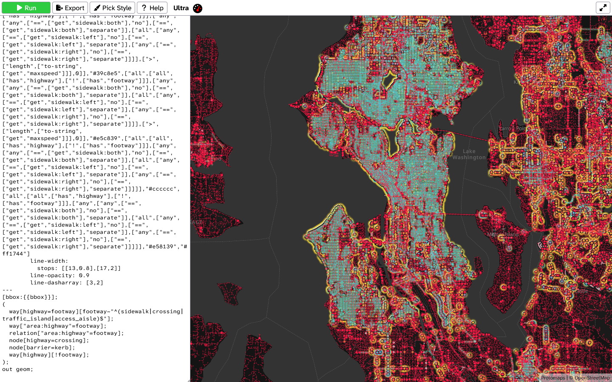

<!-- @format -->

# OSM-US-PWG

Tools and reference material for mapping sidewalks, crossings, curbs, and other pedestrian infrastructure in [OpenStreetMap](https://www.openstreetmap.org/), from the [OpenStreetMap US Pedestrian Working Group](https://wiki.openstreetmap.org/wiki/Foundation/Local_Chapters/United_States/Pedestrian_Working_Group) (PWG).

[](https://overpass-ultra.us/#query=url:https%3A%2F%2Fraw.githubusercontent.com%2Flumikeiju%2Fosm-us-pwg%2Fmain%2Fvisualizations%2Fpwg_schema_tiers.ultra)

_The [PWG Schema Tier View](#pwg-schema-maps) in Ultra. Select the image to open the live map. Map data © [OpenStreetMap contributors](https://www.openstreetmap.org/copyright)._

Everything here is built around the **[PWG Schema](https://wiki.osm.org/PWG_Schema)**, which describes how to tag pedestrian features at four levels of detail. Pick the starting point that fits how you work:

- **[Explore your area](#visualizations)**: open a ready-made map in your browser to see how well pedestrian features are mapped. Nothing to install.
- **[Map and review in JOSM](#josm-tools)**: add PWG presets, a tier-coloring map style, and tagging checks to the JOSM editor.
- **[Build on the schema](#machine-readable-schema)**: use the PWG Schema as JSON in your own apps and quality checks.
- **[Read the PWG Guide](https://wiki.osm.org/PWG_Guide)**: get started with the working group's quick-start guide to pedestrian mapping.

## PWG Schema tiers

The PWG Schema sorts tags into four tiers. Tiers build on each other: each one includes everything required by the tiers below it. The current version, **PWG Schema 1.1.1**, covers sidewalks, crossings, curbs, traffic islands, access aisles, stairs, footway areas, roadways, and traffic signs.

| Tier                                                                        | What it adds                        | Good for                            | Map color          |
| --------------------------------------------------------------------------- | ----------------------------------- | ----------------------------------- | ------------------ |
|  **Bronze**   | Basic geometry and essential tags   | Everyday pedestrian navigation      | Orange (`#e58139`) |
|  **Silver**   | Detailed geometry and tagging       | Accessibility-focused applications  | Gray (`#cccccc`)   |
|  **Gold**       | Micromapping and advanced tagging   | Advanced routers and visualizations | Yellow (`#e5c839`) |
|  **Diamond** | Specialized, regional, or rare tags | Specialized applications            | Cyan (`#39c8e5`)   |

The maps and JOSM paint style below use these colors, plus **red** (`#ff1744`) for features that need review. See the [PWG Schema](https://wiki.osm.org/PWG_Schema) wiki page for every tag at every tier.

## Visualizations

Ready-made maps for [Ultra](https://overpass-ultra.us/), a free web app that draws live OpenStreetMap data. No account or installation needed. The maps get their data from [Postpass](https://github.com/woodpeck/postpass), a public OpenStreetMap SQL service hosted by Geofabrik, rather than the often-overloaded Overpass API.

1. Select **Open in Ultra** next to a map.
2. Move to the area you want to check. A neighborhood or small town works best; large areas can be slow to load.
3. Select **Run** in the top-left corner.

### PWG Schema maps

These maps are generated from PWG Schema 1.1.1 and cover all of its features.

| Map                                  | What it shows                                                                                                                                                     | Links                                                                                                                                                                                                                                         |
| ------------------------------------ | ----------------------------------------------------------------------------------------------------------------------------------------------------------------- | --------------------------------------------------------------------------------------------------------------------------------------------------------------------------------------------------------------------------------------------- |
| **PWG Schema Tier View**             | Each feature in the color of the highest tier it meets. Red features match a PWG feature but don't yet meet its minimum tier.                                     | [Open in Ultra](https://overpass-ultra.us/#query=url:https%3A%2F%2Fraw.githubusercontent.com%2Flumikeiju%2Fosm-us-pwg%2Fmain%2Fvisualizations%2Fpwg_schema_tiers.ultra) · [File](visualizations/pwg_schema_tiers.ultra)                       |
| **PWG Schema Silver Readiness View** | Which features meet Silver, the tier for accessibility-focused applications (gray), and which still need work (red). Features that start above Silver are hidden. | [Open in Ultra](https://overpass-ultra.us/#query=url:https%3A%2F%2Fraw.githubusercontent.com%2Flumikeiju%2Fosm-us-pwg%2Fmain%2Fvisualizations%2Fpwg_schema_silver_readiness.ultra) · [File](visualizations/pwg_schema_silver_readiness.ultra) |

Colors are based on tags that can be checked automatically. Some requirements depend on real-world conditions, such as whether a sidewalk is on a hill, so confirm those with imagery or in person.

### Tag maps

| Map                           | What it shows                                                                                                                | Links                                                                                                                                                                                                                                 |
| ----------------------------- | ---------------------------------------------------------------------------------------------------------------------------- | ------------------------------------------------------------------------------------------------------------------------------------------------------------------------------------------------------------------------------------- |
| **Curb Type**                 | Curbs colored by `kerb=raised`, `lowered`, `flush`, or `no`                                                                  | [Open in Ultra](https://overpass-ultra.us/#query=url:https%3A%2F%2Fraw.githubusercontent.com%2Flumikeiju%2Fosm-us-pwg%2Fmain%2Fvisualizations%2Fcurb_type.yaml) · [File](visualizations/curb_type.yaml)                               |
| **Sidewalk Tags on Roadways** | Roads colored by their `sidewalk*=yes`, `no`, or `separate` tags, alongside mapped sidewalks, crossings, and traffic islands | [Open in Ultra](https://overpass-ultra.us/#query=url:https%3A%2F%2Fraw.githubusercontent.com%2Flumikeiju%2Fosm-us-pwg%2Fmain%2Fvisualizations%2Froadway_sidewalk_tagging.yaml) · [File](visualizations/roadway_sidewalk_tagging.yaml) |
| **Tactile Paving**            | Points colored by `tactile_paving=yes` or `no`                                                                               | [Open in Ultra](https://overpass-ultra.us/#query=url:https%3A%2F%2Fraw.githubusercontent.com%2Flumikeiju%2Fosm-us-pwg%2Fmain%2Fvisualizations%2Ftactile_paving.yaml) · [File](visualizations/tactile_paving.yaml)                     |

You can also paste a file's contents into Ultra's editor. To change colors or line styles, edit the style there; the [MapLibre Style Spec](https://maplibre.org/maplibre-style-spec/) lists every option.

## JOSM tools

Add these to the [JOSM](https://josm.openstreetmap.de/) editor by URL so you always get the latest version:

1. Open **Edit → Preferences** (<kbd>F12</kbd>).
2. Go to the settings page listed for the tool and select **+**.
3. Paste the URL, select **OK**, and restart JOSM if asked.

### PWG Schema presets

Presets for all ten PWG Schema 1.1.1 features. Fields are grouped under tier headings, so you can see what to add to reach the next tier, and conditional fields say when they apply. Find them in the **Presets** menu under **PWG Schema v1.1.1**.

- **Settings page:** Map Settings → Tagging Presets
- **URL:** `https://raw.githubusercontent.com/lumikeiju/osm-us-pwg/main/presets/pwg_schema.xml`

### PWG Schema tier paint style

Colors PWG features by the highest tier they meet, using the same [tier colors](#pwg-schema-tiers) as the Ultra maps.

- **Settings page:** Map Settings → Map Paint Styles
- **URL:** `https://raw.githubusercontent.com/lumikeiju/osm-us-pwg/main/styles/pwg_schema.mapcss`

### PWG tagging checks

Validator rules for common PWG tagging problems, with one-click fixes for typos and misspelled keys:

- Deprecated or misspelled sidewalk values, such as `sidewalk:left=none` or `sidewalk:both=seperate`
- `sidewalk:both=*` combined with `sidewalk:left=*` or `sidewalk:right=*`
- `tactile_paving:color=*` instead of `tactile_paving:colour=*`
- `tactile_paving:colour=*` on crossings, curbs, or footways without `tactile_paving=*`

- **Settings page:** Data Validator → Tag checker rules
- **URL:** `https://raw.githubusercontent.com/lumikeiju/osm-us-pwg/main/validators/pwg-tagging.validator.mapcss`

## Machine-readable schema

The PWG Schema is also available as JSON for app developers, quality-assurance tools, and data analysis:

- **[PWG Schema 1.1.1](schema/1.1.1.json)** (current): every feature, tag, tier, accepted value, and conditional requirement, with notes on how to interpret them.
- **[PWG Schema 1.0.1](schema/1.0.1.json)**: the previous version, kept for reference.

The JSON follows the published wiki schema and records a few approved rules that the wiki's tables can't express in machine-readable form, such as which crossing tags apply only to signalized crossings. For tools that read it, see [For developers](#for-developers).

## PWG document archive

Copies of PWG wiki pages, kept for reference and history.

Version-numbered files are snapshots of the named product release, not the repository release. The unversioned `.mw` files below are aliases for each product's **latest** release.

### Guide

- Latest alias: [guide.mw](guide/guide.mw)
- Shortcut: https://wiki.osm.org/PWG_Guide
- Full link: https://wiki.openstreetmap.org/wiki/Foundation/Local_Chapters/United_States/Pedestrian_Working_Group/Guide

### Schema

- Latest alias: [schema.mw](schema/schema.mw)
- Shortcut: https://wiki.osm.org/PWG_Schema
- Full link: https://wiki.openstreetmap.org/wiki/Foundation/Local_Chapters/United_States/Pedestrian_Working_Group/Schema

### Templates

#### PWG Header

- https://wiki.openstreetmap.org/wiki/Template:PWG_Header
- https://wiki.openstreetmap.org/wiki/Template:PWG_Header/doc

#### PWG Template

- https://wiki.openstreetmap.org/wiki/Template:PWG_Releases_Table
- https://wiki.openstreetmap.org/wiki/Template:PWG_Releases_Table/doc

## Versioning

This repository's release version, recorded in the [changelog](CHANGELOG.md), is independent of the versions of its subproducts, including the **PWG Schema** and **PWG Guide**. Each product advances on its own release cycle. For example, repository v1.1.0 does not imply PWG Schema v1.1.0 or PWG Guide v1.1.0.

## For developers

Requires [Node.js](https://nodejs.org/) 22 or newer. There are no npm dependencies to install. Run commands from the repository root.

### Example queries

[schema-queries.json](examples/schema-queries.json) contains worked examples of the three questions the schema is designed to answer:

- `tierOf`: given an object's tags, what tier is it mapped at?
- `tagsForTier`: what tags does a feature need at a given tier?
- `gapToTier`: what must be added or changed to reach a tier?

The examples double as checks: schema validation fails if the schema stops producing their expected results.

### Evaluating tags from the command line

[query-schema.js](scripts/query-schema.js) evaluates tags against the schema and prints JSON:

```powershell
# What tier is this sidewalk?
node scripts/query-schema.js tier-of --element way --tags highway=footway,footway=sidewalk,surface=concrete,lit=yes,width=1.5

# What does a Diamond-tier crossing way need?
node scripts/query-schema.js tags-for-tier --feature crossing_way --tier diamond

# What's missing for these stairs to reach Gold?
node scripts/query-schema.js gap-to-tier --feature stairs --tier gold --tags highway=steps,surface=concrete,incline=up,handrail=yes,ramp=no
```

`--tags` accepts comma-separated `key=value` pairs or a JSON object. Results list `blockers` that prevent a tier and `manualReviews` for requirements that depend on real-world conditions.

Feature IDs: `sidewalk`, `crossing_way`, `crossing_node`, `curb`, `traffic_island`, `access_aisle`, `stairs`, `footway_area`, `roadway`, `traffic_sign`. Tiers: `bronze`, `silver`, `gold`, `diamond`.

### Evaluating tags in JavaScript

The same evaluators are exported by [pwg-schema.js](scripts/pwg-schema.js):

```js
const { loadSchema, tierOf, gapToTier } = require("./scripts/pwg-schema");

const schema = loadSchema(); // PWG Schema 1.1.1 by default
const tags = { highway: "footway", footway: "sidewalk", surface: "concrete" };

const [match] = tierOf(schema, "way", tags);
console.log(match.featureId, match.tier); // sidewalk silver

const gap = gapToTier(schema, "sidewalk", "gold", tags);
console.log(gap.blockers.map((blocker) => blocker.key)); // [ 'lit', 'width' ]
```

### Schema versions

The default is PWG Schema **1.1.1**, selected by `CURRENT_SCHEMA_VERSION` in [pwg-schema.js](scripts/pwg-schema.js). Queries, validation, and `generate-all` use this version. This setting selects the machine-readable PWG Schema version, not the repository version; the generators do not read the `.mw` latest aliases. To use another snapshot, pass its path to an individual query or generator command with `--schema`, for example `--schema schema/1.0.1.json`.

### Validating the schema

```powershell
node scripts/validate-schema.js
```

Checks the schema's structure and runs the example queries against it.

### Regenerating assets

Regenerate the JOSM presets, paint style, and both schema-generated Ultra maps:

```powershell
node scripts/generate-all.js
```

The command validates the schema and example queries first, then stops at the first error. If a later generator fails, earlier assets may already have been updated. When adding a generator or checked-in output, update the [generator list](scripts/generate-all.js) and its [test](tests/generate-all.test.js).

To run a single generator:

```powershell
node scripts/generate-josm-preset.js
node scripts/generate-josm-mapcss.js
node scripts/generate-ultra-visualization.js
node scripts/generate-ultra-visualization.js --mode readiness --targetTier silver
```

The schema-generated Ultra maps query Postpass by default. To make an Overpass version, for example while Postpass is unavailable, add `--provider overpass` and an `--output` path so the checked-in maps aren't overwritten:

```powershell
node scripts/generate-ultra-visualization.js --provider overpass --output pwg_schema_tiers_overpass.ultra
```

### Testing

```powershell
node --test
```

Runs the full suite, which CI also runs on Ubuntu and Windows with Node.js 22, 24, and 26. The tests check reproducible regeneration in temporary workspaces without modifying tracked assets, command-line failures, schema structure, and shared tier/readiness fixtures across the query helper and generated visualization rules.

### Known limitations

- Free-text real-world conditions remain manual-review items, even when accompanied by a tag predicate.
- Ultra's conversion-based numeric checks can give different tier results than the query helper's stricter length rules for uncommon formats such as `width=1e3 m`. Shared-fixture coverage does not imply complete equivalence for every possible tag value.
- `step_count` is checked as a number, not as a nonnegative whole number. Diamond traffic-sign values other than the listed examples are not verified as specific sign codes.

## License

This repository combines material under three licenses. [LICENSE](LICENSE) summarizes them, [LICENSES/](LICENSES/) holds the full texts, and [REUSE.toml](REUSE.toml) and the notices at the top of individual files record the license of every file.

| Material                                                                                                                                              | License                                   |
| ----------------------------------------------------------------------------------------------------------------------------------------------------- | ----------------------------------------- |
| PWG Schema and PWG Guide, including every MediaWiki (`.mw`) file and the schema JSON ([schema/](schema/), [guide/](guide/), [templates/](templates/)) | [CC BY-SA 2.0](LICENSES/CC-BY-SA-2.0.txt) |
| Schema-generated [JOSM preset](presets/pwg_schema.xml), [paint style](styles/pwg_schema.mapcss), and [Ultra maps](#pwg-schema-maps)                   | CC BY-SA 2.0                              |
| This README, the [changelog](CHANGELOG.md), and other documentation                                                                                   | CC BY-SA 2.0                              |
| [JOSM validator checks](validators/) and hand-written [tag maps](#tag-maps)                                                                           | [CC0 1.0](LICENSES/CC0-1.0.txt)           |
| [Tier icons](resources/icons/tiers/)                                                                                                                  | CC0 1.0                                   |
| [Scripts](scripts/), [tests](tests/), [example queries](examples/), and repository configuration                                                      | [MIT](LICENSES/MIT.txt)                   |

The PWG Schema and PWG Guide are published on the OpenStreetMap Wiki under its [CC BY-SA 2.0 content license](https://wiki.openstreetmap.org/wiki/Wiki_content_license), and the PWG intentionally keeps that license for them here. The documentation uses the same license so text can move between this repository and the wiki. When you reuse the schema or guide, credit the "OpenStreetMap US Pedestrian Working Group and OpenStreetMap Wiki contributors" and link to the wiki page; its page history lists individual contributors.

- Files generated by the scripts take the license of the schema they're generated from, not the MIT License. Assets generated from the PWG Schema are CC BY-SA 2.0 and begin with an attribution notice; keep it when you share or modify them.
- Code examples in this README and the other documentation are also available under [CC0 1.0](LICENSES/CC0-1.0.txt), so you can copy them without attribution.
- Contributions are accepted under the license that applies to the files they change.
- These licenses apply from repository v1.2.0. Earlier releases remain available under the licenses they were published with.

CI checks every file's licensing with the [REUSE](https://reuse.software/) tool. A new file needs an entry in [REUSE.toml](REUSE.toml), or a license notice at its top if people load it by URL, like the files in [validators/](validators/) and [visualizations/](visualizations/).
